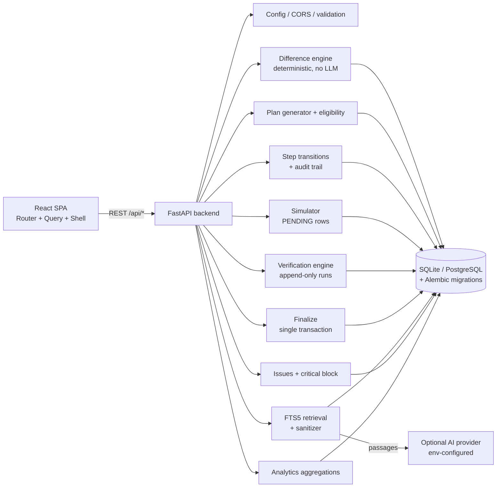
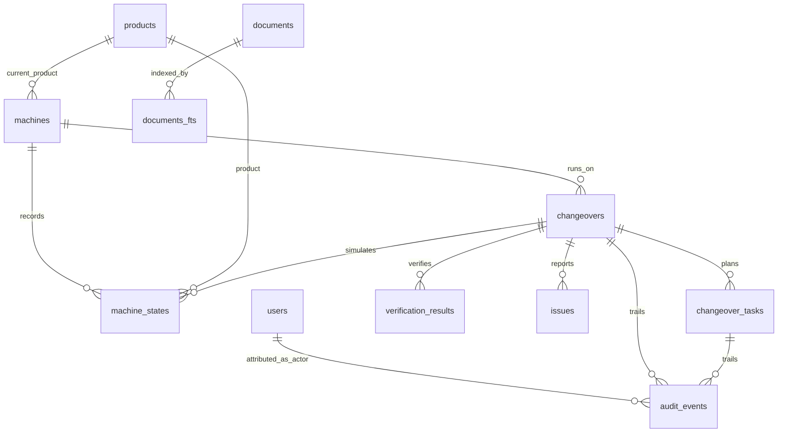

# SmartChange — Digital Setup Assistance for Assembly Line Changeovers

## 1. Problem statement

Manufacturing lines lose time and quality on product changeovers: operators inspect the
machine, hunt down work instructions, compare specifications by hand, swap components,
re-enter parameters, and verify the setup from memory. Manual changeovers cause long
preparation, wrong parameters, skipped steps, dependence on senior operators, and
repeated troubleshooting — with almost no traceability of what was done.

## 2. Solution summary

SmartChange is a software-only, state-aware changeover system. The operator picks a
target product; the backend diffs the latest **verified** machine state against the
approved product configuration, generates an ordered, prerequisite-enforced plan, guides
execution step by step, simulates parameter updates without touching official state,
deterministically verifies the result, and only then persists the new official state.
Every transition, verification run, issue, and AI interaction is recorded. Analytics and
CSV reports are computed from persisted records — never hardcoded.

> **Simulation only.** SmartChange does not connect to, control, or send commands to
> real machinery. A simulated READY never authorizes operating real equipment, and no
> factory productivity gains are claimed — measured prototype numbers are labeled as such.

## 3. Features (all verified working)

* Machine CRUD (search, filters, pagination, guarded deletes) — Phase 2
* Product CRUD + validated setup configurations (RPM/°C/bar/ml) — Phase 2
* Deterministic difference engine (5 parameters, categories, per-value validation) — Phase 3
* Ordered plan generation (safety → components → parameters → verification, estimates labeled) — Phase 3
* Machine eligibility (Offline/Fault block, Maintenance warns) + no-change plans — Phase 3
* Operator workspace (start/confirm/fail/retry, notes, progress %, remaining time, audit trail) — Phase 4
* Issues with severity; open **critical** issues block execution until resolved — Phase 4
* Configuration simulator (initial/target/simulated/official kept separate) — Phase 5
* Verification engine (append-only runs, per-check reasons, PENDING/FAILED/VERIFIED/READY) — Phase 5
* Transactional finalization (re-verifies; failures never touch official state) — Phase 5
* Document upload (PDF/TXT), Draft→Approved→Archived workflow, FTS5 retrieval — Phase 6
* Optional AI SOP assistant (works without any provider; citations; injection-safe) — Phase 6
* Analytics dashboard (8 KPIs, 7 chart groups, filters), history, CSV exports — Phase 7

## 4. Limitations (honest)

* No real authentication: demo identities (operator/supervisor/engineer) selected in the
  header, attributed in the audit log. No passwords, no roles, no access control.
* No real-machine integration, no safety certification, no factory results.
* Keyword retrieval only (no semantic search); scanned-image PDFs yield no text.
* AI provider path is tested with mocks, not against a live LLM.
* Pytest shares the dev SQLite file, so test runs reset demo history (re-run seeds after).
* Single-server prototype: no concurrency control beyond database transactions.

## 5. Technology stack

Frontend: React 19 + TypeScript (strict) + Vite 8 + Tailwind CSS 4 + React Router 8 +
TanStack Query 5 + Lucide icons + Recharts + axios.
Backend: Python + FastAPI + SQLAlchemy 2 + Pydantic 2 + Alembic + pypdf + pytest.
Database: SQLite (local) / PostgreSQL via `DATABASE_URL`. AI: optional
OpenAI-compatible Chat-Completions endpoint over stdlib urllib; retrieval is SQLite FTS5.

## 6. Architecture



Module responsibilities (`backend/app/`): `config.py` env; `database.py` engine/session;
`models.py` schema; `schemas.py` validation; `seed.py` + `demo_seed.py` + `reset_demo.py`
data; `engine.py` diff/plan/verify; `validation.py` product-config rules;
`retrieval.py` FTS + sanitizing; `providers.py` optional LLM; `analytics.py`
aggregations; `main.py` routes (thin, delegating to services).



## 7. Prerequisites

* Python 3.12+ with pip · Node.js 20+ with npm · (optional) an OpenAI-compatible API key

## 8. Environment variables

Backend (`backend/.env.example` → copy to `backend/.env`, all optional):
`DATABASE_URL` (default `sqlite:///./smartchange.db`), `FRONTEND_ORIGINS`,
`SMARTCHANGE_AI_PROVIDER` (`none` | `openai-compatible`), `SMARTCHANGE_AI_BASE_URL`,
`SMARTCHANGE_AI_API_KEY` (never commit), `SMARTCHANGE_AI_MODEL`,
`SMARTCHANGE_AI_TIMEOUT_SECONDS`, `SMARTCHANGE_DOCS_MAX_MB`.
Frontend (`frontend/.env.example` → `frontend/.env`): `VITE_API_BASE_URL`
(empty = same origin via Vite `/api` proxy).

## 9. Install, migrate, seed, run

```powershell
cd backend
pip install -r requirements.txt
copy .env.example .env        # optional; defaults work locally
python -m alembic upgrade head   # create/migrate database (repeatable, stamped)
uvicorn app.main:app --port 8000 # API + Swagger at http://127.0.0.1:8000/docs
python -m pytest tests -v        # backend suite (resets dev DB file — reseed after)

cd frontend
npm install
copy .env.example .env        # optional
npm run dev                   # http://localhost:5173 (proxies /api to :8000)
npm run lint                  # oxlint
npx tsc --noEmit -p tsconfig.app.json  # strict type-check (npm run build runs tsc -b)
npm run build                 # production bundle into dist/
```

Demo data commands (all explicit, idempotent, user data safe):

```powershell
cd backend
python -m app.demo_seed    # 7 labeled simulated changeovers for analytics (skips if present)
python -m app.reset_demo   # remove demo-seed rows, restore FILL-01/FILL-02/PACK-01 + A/B/C baseline
```

Demo identities (no passwords — prototype only): `demo-operator` (operator),
`supervisor` (supervisor), `engineer` (engineer). Switch in the header; every write is
audit-attributed. No real accounts exist.

## 10. Demo walkthrough (uses only the real workflow)

Setup: `python -m app.reset_demo` → FILL-01 Operational on Product A.

1. Sign in via header demo identity (`demo-operator`).
2. Machines → open Filling Machine 01 → confirm Product A, 100 RPM / 70 °C / 2.5 bar.
3. Changeovers → select FILL-01 → target Product B → Compare configurations.
4. Confirm 5 differences (nozzle, fixture, speed, temperature, pressure) + 7 ordered steps.
5. Start changeover → workspace opens at `/changeovers/:id`.
6. Start + confirm LOTO, nozzle, fixture steps in order (out-of-order is rejected with 409).
7. Simulator: apply speed 120, temperature 75, pressure **2.5 (wrong)**.
8. Run verification → FAILs with reasons; Finalize → blocked (409); official state still A.
9. Correct pressure to 3.0 → re-verify → all PASS (run history preserved).
10. Finalize (confirm dialog) → COMPLETED, simulated READY.
11. Machines → FILL-01 now officially Product B @ 120/75/3.0.
12. History → new row, verification PASS, 7 changes; open it for steps + audit trail.
13. Analytics → totals/success/verification metrics include the record.
14. Export CSV → open it, confirm the row and escaped fields.

3–5 minute competition script: steps 3–7 (preview→start→2 steps, 60s), jump to simulator
with the wrong pressure (verify FAIL + reason, 60s), correct + verify + finalize (60s),
Machines + History + Analytics + CSV (60s), assistant question with citations (30s).

## 11. Troubleshooting

* Backend unreachable from UI: start it first (`uvicorn app.main:app --port 8000` in
  `backend/`); the UI shows “Backend unreachable” with retry.
* Empty dashboard after tests: pytest resets the dev DB — run `python -m app.demo_seed`
  (analytics demo) or just use the app (auto-seeds machines/products/docs).
* Port in use: change `--port` / Vite `--port`; update `FRONTEND_ORIGINS` / proxy target.
* `alembic upgrade head` on an existing DB: safe, additive; use `alembic stamp head`
  only if the schema already matches.
* AI answers say no provider: set the `SMARTCHANGE_AI_*` vars and restart the backend;
  excerpts still work without any provider.

## 12. Test commands and results (Phase 8)

```powershell
cd backend
python -m pytest tests -q          # 53 passed (workflow, management, planning, execution,
                                   # simulation A–E, assistant, analytics)
python -m alembic check            # clean: no model/migration drift
cd ..\frontend
npm run lint                       # clean
npx tsc --noEmit -p tsconfig.app.json  # clean (strict)
npm run build                      # dist/ built
```

Drift is additionally covered by the fresh-database migration test (`base → head` on an
empty file, then seed + FTS check — passed).
Frontend has no unit-test runner configured (honest gap — covered by strict type-check,
lint, production build, and backend end-to-end workflow tests).
